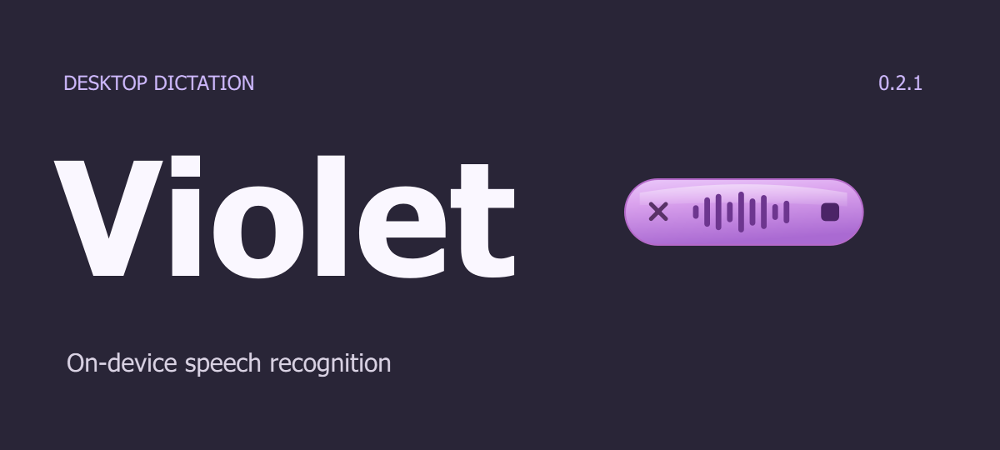
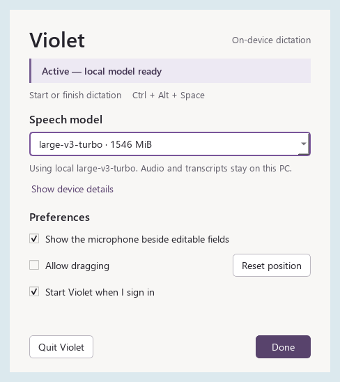

<p align="center"></p>

<p align="center"><strong>Local English dictation for the desktop.</strong></p>

<p align="center">Windows 10/11 x64 · macOS and Linux preview · Offline after setup · MIT</p>

<p align="center"><a href="https://github.com/LeightonR/violet/releases/download/v0.2.1/Violet-0.2.1-win64-setup.exe"><strong>Download Violet 0.2.1 for Windows</strong></a> · <a href="https://github.com/LeightonR/violet/releases/download/v0.2.1/Violet-0.2.1-win64-portable.zip">Portable ZIP</a> · <a href="docs/FAQ.md">FAQ</a> · <a href="PRIVACY.md">Privacy</a></p>

Click a text field. Violet appears just to the left of the active text row.
Click the microphone, speak, then click the square Stop control. Your words
arrive in that field with model-generated capitalization and punctuation. The
X discards an active recording or pending result.

Violet is an early **beta**. It works with supported Windows accessibility
controls; unusual editors may need the copy-and-paste fallback. English is the
initial dictation language.

## Install

1. Download [Violet 0.2.1 Setup](https://github.com/LeightonR/violet/releases/download/v0.2.1/Violet-0.2.1-win64-setup.exe)
   for Windows x64. A [portable ZIP](https://github.com/LeightonR/violet/releases/download/v0.2.1/Violet-0.2.1-win64-portable.zip)
   is also provided; extract the entire ZIP before launching. No Python installation is needed.
2. Run Setup as your normal user. It installs Violet for your account, adds
   shortcuts, and enables startup at sign-in by default.
3. Open Violet. Its first-run setup detects your CPU and memory and recommends
   a speech model. Download the model, then let it warm up. Model files are
   stored locally and reused on later launches.
4. Focus an editable field and click the violet microphone to dictate.

Updating? Quit Violet and run the new Setup. Your settings, relative placement,
and downloaded models are preserved.

The current release is unsigned. Verify the [release checksums](https://github.com/LeightonR/violet/releases/download/v0.2.1/SHA256SUMS.txt)
if Windows shows an unknown-publisher warning. See [Security](SECURITY.md) for details.

**Requirements:** Windows 10 version 1809 or later / Windows 11, x64 CPU with
SSE4.1, microphone, space for the app and selected model, and internet for model
setup. No GPU, API key, or cloud transcription subscription is required.

### Optional NVIDIA acceleration

CPU INT8 remains Violet's default. To use an NVIDIA GPU on Windows, quit Violet
and run this bundled, per-user installer from PowerShell:

```powershell
powershell.exe -NoProfile -ExecutionPolicy Bypass -File "$env:LOCALAPPDATA\Programs\Violet\Install-VioletCudaRuntime.ps1"
```

For the portable ZIP, run the included script from the extracted Violet folder
instead.

It downloads two pinned NVIDIA CUDA Installer Team wheels from PyPI, verifies
their SHA-256 values, and extracts only Violet's local CUDA 12 DLLs and licenses
under `%LOCALAPPDATA%\Violet\runtime\cuda12`. It does not install a CUDA
Toolkit, change drivers, change the system `PATH`, or affect another app. The
exact packages are
[`nvidia-cublas-cu12` 12.9.2.10](https://pypi.org/project/nvidia-cublas-cu12/12.9.2.10/)
and [`nvidia-cudnn-cu12` 9.28.1.4](https://pypi.org/project/nvidia-cudnn-cu12/9.28.1.4/);
the [installer source](packaging/Install-VioletCudaRuntime.ps1) records the
exact file URLs and hashes. It downloads approximately 1.17 GiB and uses about
1.86 GiB locally.

Restart Violet, enable **Use NVIDIA GPU acceleration** in its control panel,
then restart once more. Unsupported or unavailable CUDA falls back to CPU. To
opt out, uncheck the setting and restart; the CPU path remains fully portable.

On the upgrade workstation's RTX 5090, Violet transcribed the padded
19.451-second benchmark fixture in 0.252 seconds median after warm-up with
CUDA FP16, compared with 3.638 seconds on CPU INT8. That is a local speed
measurement, not a general accuracy claim; the two modes can produce a slightly
different result for ambiguous speech.

## Google Docs on Windows

Click the document body and dictate with the microphone or **Ctrl+Alt+Space**. For precise bubble placement, load the bundled **Violet Docs Caret** extension in Chrome. Open **Manage extensions**, turn on **Developer mode**, choose **Load unpacked** and select `%LOCALAPPDATA%\Programs\Violet\docs-caret`. Reload your open Google Doc. The extension runs only on Google Docs and forwards caret geometry to Violet.

## macOS and Linux source preview

Install Python 3.12. On Debian or Ubuntu install `libportaudio2` and `python3-venv`. On macOS allow microphone access for the app or terminal launching Violet. From a source checkout run the following commands. You can also download the [Python wheel](https://github.com/LeightonR/violet/releases/download/v0.2.1/violet_desktop_dictation-0.2.1-py3-none-any.whl) and pass its local filename in place of the dot in the install command.

```sh
python3.12 -m venv .venv
.venv/bin/python -m pip install .
.venv/bin/python -m violet
```

Download the displayed English model once. Choose **Start recording**, speak, then **Finish recording**. Choose **Copy transcript** and paste into the destination. The floating microphone, global shortcut and automatic insertion below are Windows features.

## Small controls, useful details

| Control | What it does |
| --- | --- |
| Floating microphone | Start recording; X discards; the square Stop control transcribes and inserts. |
| Ctrl+Alt+Space | Start or finish dictation from the keyboard; unsupported fields use recovery Copy. |
| Show the microphone beside editable fields | Pause or resume the widget and recording. |
| Allow dragging | Drag to set a position relative to the active text row; uncheck to lock it. |
| Reset position | Restore the default left-side placement. |
| Start Violet when I sign in | Enable or disable per-user automatic startup. |
| Quit Violet | Exit and release the resident speech model. |

Open the desktop or Start-menu shortcut for the control panel. You can pin it
to your taskbar. Closing the panel leaves Violet in the tray.

<p align="center"></p>

The floating microphone keeps its original orchid gradient and waveform. The meter
shows nine small rounded dots while quiet, growing into thicker warm-violet bars
when you speak. A sensitive visual level scale makes normal speech use more of
the available height without changing the recorded audio.
Its motion follows elapsed time and the platform's display-update cadence where
available, rather than promising one fixed frame rate. The widget holds its
position during selection and transient caret updates.

## Your CPU, a sensible model

Violet uses [faster-whisper](https://github.com/SYSTRAN/faster-whisper) and
[CTranslate2](https://opennmt.net/CTranslate2/) for CPU inference, with Whisper
models supplying punctuation and casing. CPU and memory detection choose a
starting configuration that leaves room for the rest of your desktop.

| Model | Download | Minimum total / available RAM | Logical CPUs |
| --- | ---: | ---: | ---: |
| tiny.en | 75 MiB | 2 / 1 GiB | 1 |
| base.en | 141 MiB | 4 / 2 GiB | 2 |
| small.en | 464 MiB | 6 / 3 GiB | 4 |
| large-v3-turbo | 1,547 MiB | 12 / 7 GiB | 8 |

These are startup selection thresholds, not measured minimums for every
computer. Violet caps inference threads and uses INT8 when supported. The
hardware heuristic does not establish which model is best for every speaker.
The [included benchmark](benchmarks/README.md) documents one synthetic-speech
comparison and its limits; it is not a general accuracy evaluation.

## Local by design

- No transcript history, audio recording files, analytics, or account.
- Audio and transcripts stay in memory while processing. Model setup downloads
  weights; normal dictation afterward can run offline.
- Violet checks accessibility metadata and caret geometry rather than reading
  existing text field contents.
- Password/read-only fields are excluded when identified by their application.
- If the original target changes or cannot be verified, a recovery window lets
  you copy the result. Violet does not press Enter to submit it.

Settings and model files live in `%LOCALAPPDATA%\Violet`. Pause keeps the model
warm; Quit releases it. See [Privacy](PRIVACY.md), [Security](SECURITY.md), and
the [FAQ](docs/FAQ.md) for details and limitations.

## Development

Use 64-bit Python 3.12 on supported Windows:

```powershell
py -3.12 -m venv .venv
.\.venv\Scripts\python.exe -m pip install -r requirements.txt
.\.venv\Scripts\python.exe -m violet --control-panel
```

The setup scripts at the repository root are developer conveniences. End users
should use the release installer or portable build. Build instructions and the
release workflow are described in [Building](docs/BUILDING.md).

Regression tests cover target identity, protected fields, caret placement,
selection/drag interaction, voice activity gating, and model setup. App-owned
integration fixtures use dummy text rather than personal conversations.

Bug reports are welcome. Include your Violet version, Windows version,
application name, and reproduction steps with dummy text. Leave recordings,
private transcripts, credentials, and personal screenshots out of public issues.

Want to share Violet? The [launch card](docs/images/violet-011-launch.png) and
[editable SVG](docs/images/violet-011-launch.svg) are ready to use. Link people to
the [official release](https://github.com/LeightonR/violet/releases/tag/v0.2.1).

## License and acknowledgments

Violet's source is [MIT licensed](LICENSE). Packaged dependencies and downloaded
models retain their own licenses. Thank you to the Whisper, faster-whisper,
CTranslate2, Silero VAD, Qt/PySide, and Python communities.

Violet is an independent project and is not affiliated with OpenAI or Microsoft.
