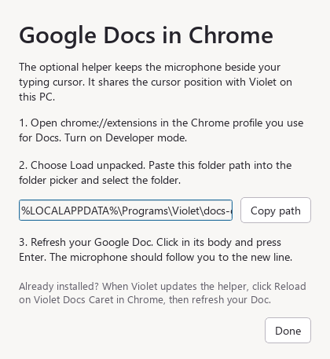

# Set up Google Docs in Chrome

On Windows, Violet can dictate into the body of a Google Doc. The optional **Violet Docs Caret** extension keeps the floating microphone beside your typing cursor. It sends the cursor rectangle to Violet on your PC. The helper does not read document text or record audio.

## First-time setup

1. Run the [Violet Windows installer](https://github.com/LeightonR/violet/releases/download/v0.2.2/Violet-0.2.2-win64-setup.exe). It installs the extension files and registers their local connection with Chrome for your Windows account.
2. Open Violet’s control panel from the tray or Start menu. Choose **Set up Google Docs**, then **Copy path**.
3. In the Chrome profile you use for Docs, enter `chrome://extensions` in the address bar. Turn on **Developer mode** and choose **Load unpacked**.
4. Paste the copied path into the folder picker and select the **docs-caret** folder. Chrome should list **Violet Docs Caret** as enabled.
5. Refresh an open Google Doc. Click in its body and press **Enter**. The bubble should follow the cursor to the next line. Choose the microphone or press **Ctrl+Alt+Space** to start dictating.

The default folder is `%LOCALAPPDATA%\Programs\Violet\docs-caret`. Use the Windows installer for this integration. The portable ZIP alone does not register the browser connection.

## Updates and troubleshooting

- **Already using the helper?** Keep it installed. When an update changes it, click **Reload** on the Violet Docs Caret card, then refresh every open Doc where you want to use it.
- **The bubble stays still?** Check that Violet is running and **Show the microphone beside editable fields** is on. Confirm that the extension is enabled in the same Chrome profile as the Doc. Refresh the tab and click in the document body.
- **Developer mode unavailable?** Your organization may manage this setting. You can still dictate with Violet. Ask your browser administrator about enabling precise caret tracking.
- **Remove the helper** from its card at `chrome://extensions`. The desktop app remains available.

[Chrome’s instructions for loading and reloading an unpacked extension](https://developer.chrome.com/docs/extensions/get-started/tutorial/hello-world)
