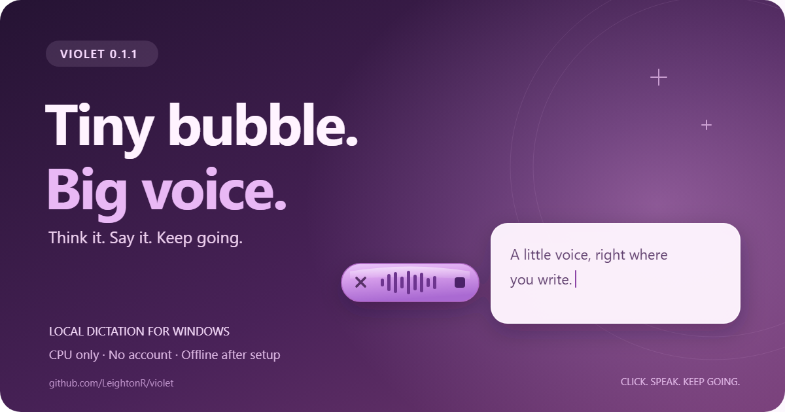
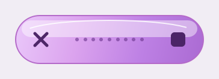
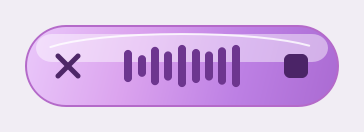

**Think it. Say it. Keep going. 💜**

Violet is a little purple voice companion that sits beside the text row you're
working in. Click the microphone, speak your thought, and hit the square Stop
button to put it into the field—with model-generated punctuation and casing.
Your Windows CPU does the transcription. No GPU, account, API key, or cloud
transcription subscription required.

## Get Violet

**[Download the Windows installer](https://github.com/LeightonR/violet/releases/download/v0.1.1/Violet-0.1.1-win64-setup.exe)**
· [Portable ZIP](https://github.com/LeightonR/violet/releases/download/v0.1.1/Violet-0.1.1-win64-portable.zip)
· [SHA-256 checksums](https://github.com/LeightonR/violet/releases/download/v0.1.1/SHA256SUMS.txt)
· [File manifest](https://github.com/LeightonR/violet/releases/download/v0.1.1/artifact-manifest.json)

Windows 10 version 1809 or later / Windows 11, x64 with SSE4.1. Install as your
normal user. First-run setup recommends a model from your CPU and available
memory; download it once, then dictate locally. No Python installation needed.

Updating from 0.1.0? Quit Violet and run Setup. Your settings, placement, and
downloaded models are preserved. For the portable edition, extract the entire
ZIP into a fresh folder before launching.

## What's new

- **A waveform that follows your voice.** The meter advances on fresh audio
  measurements. Voice detection retains context between frames to reduce
  flicker during a phrase and avoid repeating stale patterns.
- **More voice, more violet.** Thicker, taller, spaced bars and increased visual
  sensitivity give ordinary speech more room to move, with headroom for louder
  syllables. The recorded audio is unchanged.
- **Quiet has a look, too.** Nine visible rounded square dots show quiet
  listening. Silence and rejected noise return to that static row.
- **A little spring in its step.** The bubble gently springs open and closed.
  Voice activity doesn't restart the opening animation, and the meter stays
  clear of the controls.
- **Keep it or cancel it.** The right-hand square Stop button finishes and
  inserts. The left-hand X discards the recording or pending result. Cancelled
  results cannot arrive late and insert themselves.
- **Warm purple, clean pixels.** The widget uses orchid and violet throughout,
  with no blue/cyan accents. Drawing is aligned for common Windows display
  scales; animation follows elapsed time and available display updates.
  Settled quiet states stop animating.
- **Stronger integration checks.** Coverage now exercises the actual Stop and
  Cancel controls, alongside speech gating, caret placement, protected fields,
  target identity, and recovery behavior.
- **Your completed words stay recoverable.** An unexpected error at the Windows
  insertion boundary now opens recovery Copy instead of silently losing the
  finished transcript. Existing checks still refuse a changed or unsafe target.

| Quiet listening | Speaking |
| --- | --- |
|  |  |

*App-owned previews use synthetic meter input; no personal recordings or text.*

Validation includes 59 passing regression tests, an app-owned Windows integration
fixture exercising Stop-to-insert and changed-target recovery, renders at four
display scales, and packaged local-inference, dependency, and privacy checks.

## Tiny controls, useful superpowers

**Ctrl+Alt+Space** starts or finishes dictation. The control panel lets you pause
the widget, choose a model, change startup behavior, or quit to release resources.
Enable **Transform position**, drag the bubble to your preferred position relative
to the active text row, then uncheck it to lock that placement. Desktop and
Start-menu shortcuts open the panel; you can pin it to the taskbar.

## A few things to know

English is the initial dictation language. Violet supports text controls that
expose usable Windows accessibility data; custom editors may need recovery
**Copy**. Password/read-only fields are excluded when their application identifies
them. Violet does not press Enter to submit your words. Review dictated text,
especially names and numbers.

This remains an early, unsigned desktop utility, tested on Windows 11. Windows
may show an unknown-publisher warning. CPU speed, model accuracy, accessibility
support, and frame delivery vary by machine and application. There is no claim of
an independent security audit or universal application compatibility.

## Everything you need

[Quick start](https://github.com/LeightonR/violet/tree/v0.1.1#install)
· [FAQ and troubleshooting](https://github.com/LeightonR/violet/blob/v0.1.1/docs/FAQ.md)
· [Privacy](https://github.com/LeightonR/violet/blob/v0.1.1/PRIVACY.md)
· [Security and verification](https://github.com/LeightonR/violet/blob/v0.1.1/SECURITY.md)
· [Full changelog](https://github.com/LeightonR/violet/blob/v0.1.1/CHANGELOG.md)
· [Source and build instructions](https://github.com/LeightonR/violet/blob/v0.1.1/docs/BUILDING.md)
· [Report a bug](https://github.com/LeightonR/violet/issues)

Know someone whose thoughts move faster than their typing? Send them Violet. 💜
The [share card](https://raw.githubusercontent.com/LeightonR/violet/v0.1.1/docs/images/violet-011-launch.png)
and [editable SVG](https://github.com/LeightonR/violet/blob/v0.1.1/docs/images/violet-011-launch.svg)
are yours to use. Keep private recordings, transcripts, and screenshots out of
public bug reports.

Violet is an independent MIT-licensed project, not affiliated with OpenAI or
Microsoft. Dependencies and speech models retain their own licenses.
