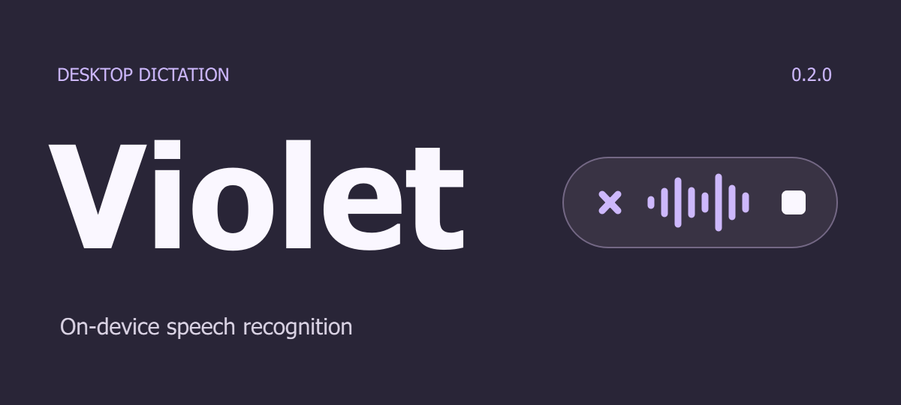

## Windows

Violet can recognize focused browser editors that expose their typing target inside an off-screen frame. It uses visible ancestor geometry to place the microphone and checks the original target again before inserting text. Writable search comboboxes are also supported. If the target changes, Violet offers the result in its recovery window.

The microphone now uses a charcoal surface and a high-contrast lavender meter. The control panel groups model setup, preferences and device details. Open it from the tray or launch shortcut. Press **Ctrl+Alt+Space** in a supported field to start or finish dictation.

[Windows installer](https://github.com/LeightonR/violet/releases/download/v0.2.0/Violet-0.2.0-win64-setup.exe) · [Windows portable ZIP](https://github.com/LeightonR/violet/releases/download/v0.2.0/Violet-0.2.0-win64-portable.zip) · [SHA-256 checksums](https://github.com/LeightonR/violet/releases/download/v0.2.0/SHA256SUMS.txt)

Windows packages are unsigned. Quit an older Violet instance before upgrading. Existing model downloads and settings are reused.

## macOS and Linux preview

The Python 3.12 source distribution includes a recording window for local dictation. Download the displayed English model, record, then copy the transcript and paste it into your editor. Automatic insertion and the floating microphone are Windows features in this version. See the [platform instructions](https://github.com/LeightonR/violet/tree/v0.2.0#macos-and-linux-source-preview).

## Verification

The Ubuntu recording window was exercised with synthetic speech and a local model. The Windows package is built with an advisory audit, an offline inference smoke check and a personal-path scan. Live microphone behavior varies with the selected input device. For custom editors, transcription recovery remains available when Violet cannot verify the destination.
