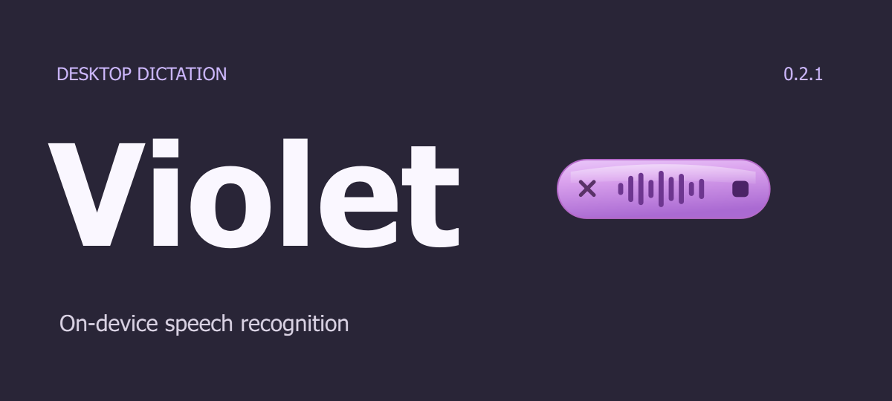

## Windows

Violet can recognize focused browser editors that expose their typing target inside an off-screen frame. A live Google Docs check confirmed that Violet inserted a sentence into the document body. Violet checks the original field again before delivering a transcript. Writable search comboboxes are also supported. If the target changes, Violet offers the result in its recovery window.

For precise caret positioning in Google Docs on Chrome, open Chrome's Extensions page, enable Developer mode, choose **Load unpacked**, and select `%LOCALAPPDATA%\Programs\Violet\docs-caret`. Reload the document. The optional helper forwards the visible caret rectangle to this PC. The Windows installer registers the native host. Ordinary dictation works without the helper.

The floating microphone retains its orchid finish and is 20% smaller in each dimension. The Docs helper follows the local typing caret across line breaks, holds its position during a blink, and ignores collaborator cursors and stale updates. If you previously loaded the helper, click Reload on Violet Docs Caret in Chrome’s Extensions page, then refresh your document.

The control panel groups model setup, preferences and device details. Open it from the tray or launch shortcut. Press **Ctrl+Alt+Space** in a supported field to start or finish dictation.

[Windows installer](https://github.com/LeightonR/violet/releases/download/v0.2.1/Violet-0.2.1-win64-setup.exe) · [Windows portable ZIP](https://github.com/LeightonR/violet/releases/download/v0.2.1/Violet-0.2.1-win64-portable.zip) · [SHA-256 checksums](https://github.com/LeightonR/violet/releases/download/v0.2.1/SHA256SUMS.txt)

Windows packages are unsigned. Quit an older Violet instance before upgrading. Existing model downloads and settings are reused.

### Optional NVIDIA acceleration

On the test RTX 5090, warm decoding of a 19.45-second synthetic English clip took about 0.252 seconds on GPU and 3.64 seconds on CPU. One phrase differed between backends. These are model decoding times for that fixture. CPU remains the default. See the [benchmark](https://github.com/LeightonR/violet/blob/v0.2.1/benchmarks/README.md) and [setup details](https://github.com/LeightonR/violet/blob/v0.2.1/docs/FAQ.md).

## macOS and Linux preview

The [Python 3.12 wheel](https://github.com/LeightonR/violet/releases/download/v0.2.1/violet_desktop_dictation-0.2.1-py3-none-any.whl) and source distribution include a recording window for local dictation. Download the displayed English model, record, then copy the transcript and paste it into your editor. Automatic insertion and the floating microphone are Windows features in this version. See the [platform instructions](https://github.com/LeightonR/violet/tree/v0.2.1#macos-and-linux-source-preview).

The transcription worker also repairs stray spaces next to recognized punctuation and brackets.

## Verification

The macOS and Ubuntu recording windows were exercised with synthetic speech and local inference. The Windows package is built with an advisory audit, an offline inference smoke check and a personal-path scan. Live microphone behavior varies with the selected input device. For custom editors, transcription recovery remains available when Violet cannot verify the destination.
